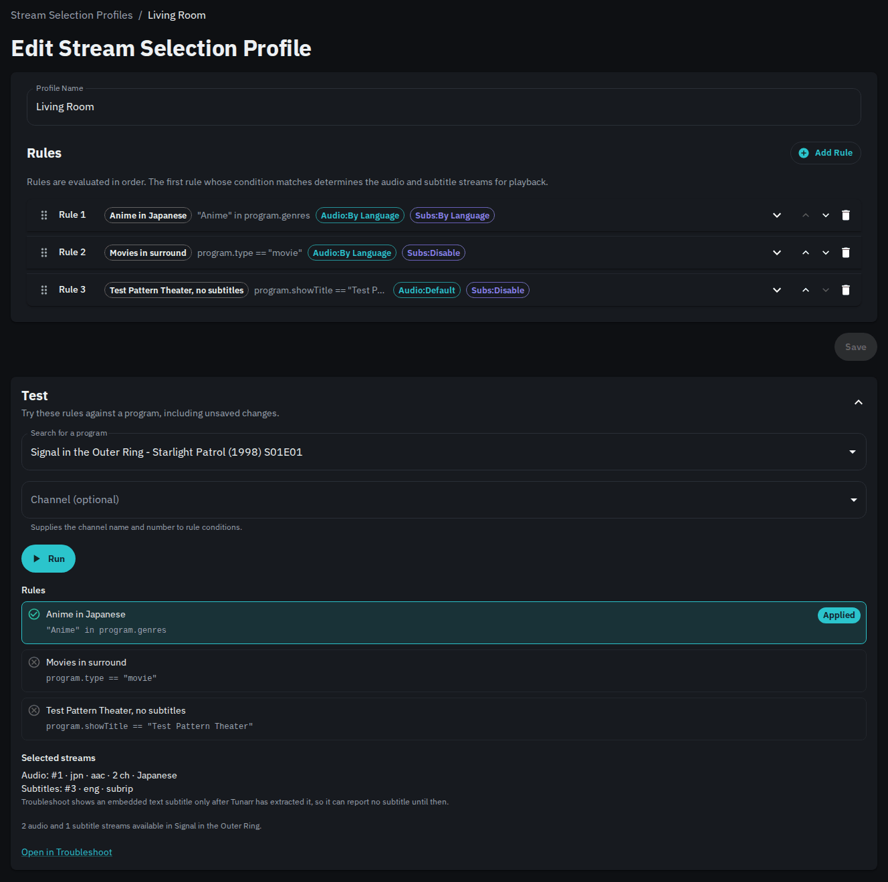
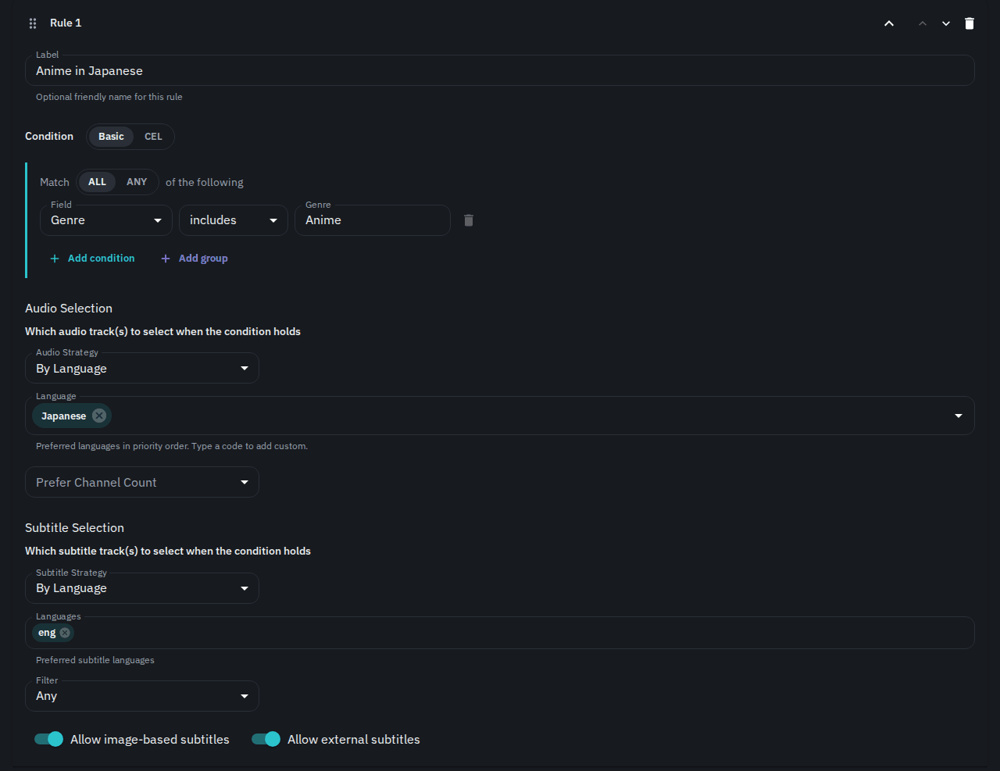
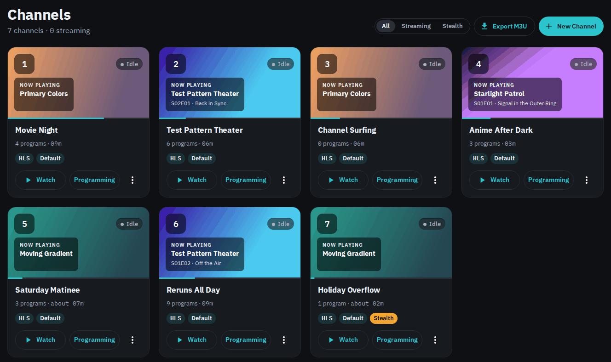
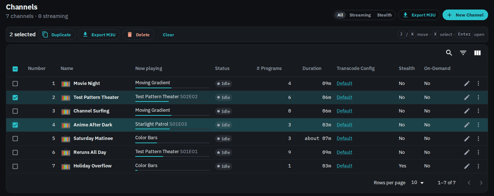
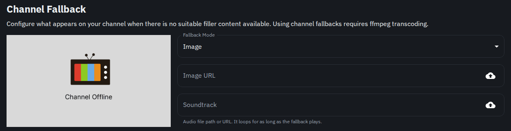

# Tunarr 2026.11.2: Stream Selection Profiles

Tunarr now picks audio and subtitle tracks with **stream selection profiles**. A profile is an ordered list of rules, and each rule says which audio track to play and which subtitles to show when its condition matches. One profile can give anime Japanese audio with English subtitles, play the surround track for movies, and leave everything else on the file's defaults.

This release also rebuilds the Channels page, with bulk actions and keyboard navigation, and lets the channel fallback loop a soundtrack you upload.

<!-- more -->

## What profiles replace

Earlier versions split stream selection across two places. Preferred audio languages were a global setting under **Settings > FFmpeg**, and each channel had its own **Enable Subtitles** switch and subtitle languages. Profiles replace both, and you manage them under **Profiles > Stream Selection**.

Tunarr converts your old settings on upgrade, and playback should not change. Your preferred audio languages become a profile named **Migrated Defaults**, which becomes the default. Each set of channel subtitle preferences becomes its own profile, assigned to the channels that used it. See [Upgrading from earlier versions](../../../configure/stream-selection.md#upgrading-from-earlier-versions) for the one case worth checking.

## Rules and conditions

Tunarr checks rules from top to bottom, and the first rule whose condition matches decides the tracks. The editor's **Basic** mode builds conditions from program type, title, show, genre, library, track languages, and audio channel count. **CEL** mode takes any expression, such as `hasAudioLang("jpn") && program.type == "episode"`.

The **Test** panel runs your rules against a real program before you save, and shows which rule matched and which tracks it picked.

## Where profiles apply

You can assign a profile to a channel, a filler list, or a custom show. When a program plays, Tunarr tries the custom show or filler list profile first, then the channel's profile, then the default profile. A profile with no matching rule passes the program to the next one in that order. So a bumpers filler list can hold one rule that turns subtitles off, while the channel's profile handles everything else.

**System > Troubleshoot** shows every profile and rule Tunarr checked for a program, which helps when a track isn't the one you expected.

Read the full guide in [Stream Selection](../../../configure/stream-selection.md).

## A new Channels page

The Channels page now shows a card for each channel. A card shows what's playing now, with its artwork and progress, whether anyone is watching, and buttons to watch the channel or edit its programming. The **All / Streaming / Stealth** filter at the top narrows the list.

Set **Settings > General > Density** to **Dense** to see the channels as a table instead. Select rows to duplicate, export, or delete several channels at once. **Export M3U** downloads a playlist of only the selected channels. Keyboard users can press J and K to move between rows, X to select a row, and Enter to open it.

## Smaller changes

- **Fallback soundtrack.** The channel fallback now plays its **Soundtrack** and loops it for as long as the fallback runs, on both streaming backends. The field has an upload button, so you can store the audio file on the Tunarr server. See [Flex](../../../configure/channels/flex.md).

    

- **Remove a slot schedule.** A channel saved from the Slot Editor or Time Slots editor used to keep that schedule forever. The programming page notice now has a **Remove schedule** button, which returns the channel to manual programming and keeps its current programs. See [Removing a Slot Schedule](../../../configure/scheduling/concepts.md#removing-a-slot-schedule).
- **Clearer watermark timing.** The watermark form now splits its timing into **Fade In and Out** and **Time Limit**. The limit is renamed **Hide Watermark After** and is entered in minutes. See [Watermarks](../../../configure/channels/watermarks.md).
- **Failed loads say so.** When a page can't load its data, Tunarr shows a message with a **View logs** button instead of an empty list.

## Notable fixes

- In `hls` mode, audio no longer drifts behind video at each program change. Players that play every audio sample, such as Jellyfin through the HDHomeRun endpoint, fell about 25 ms further behind at each change.
- With the ErsatzTV next backend, programs with a fractional duration no longer play as the error screen.
- WebVTT subtitle sidecars work again. Every subtitle request returned 404 since 2026.10.4.
- Local media scans keep sidecar subtitles, audio channel counts, and default track flags, which stream selection rules read. Files scanned before this release may keep the old data.
- VAAPI encoding now writes consistent SDR color information, which stops a decoder freeze on some players when mixed clips change.
- A custom XMLTV output path in `settings.json` now survives restarts.
- HLS sessions now stop transcoding sooner after the last viewer leaves. The default staleness window drops from 120 to 60 seconds, and `TUNARR_SESSION_STALENESS_MS` still overrides it.
- ErsatzTV next is updated to v0.2.5.

## Breaking change for API clients

`GET /api/media-libraries/:libraryId/programs` is now paged. It takes `offset` and `limit` (default 100, maximum 1000) and returns `{ total, result, size, offset }` instead of a plain array. Large libraries used to run the server out of memory on this endpoint. Tools that call it, such as Programmarr, need an update.
