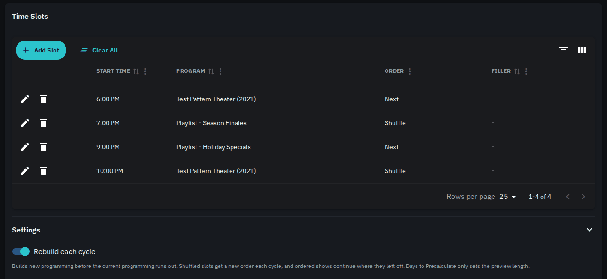
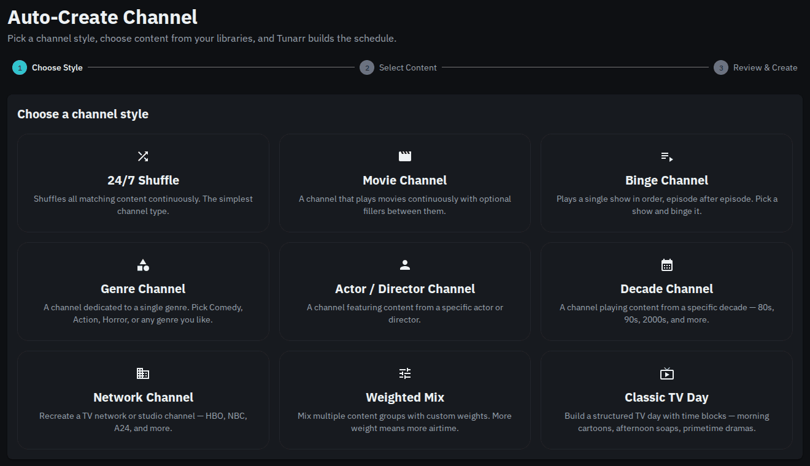
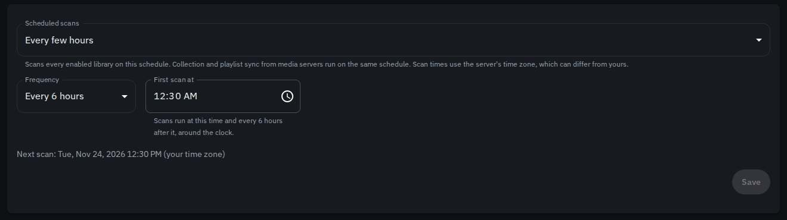

# Tunarr 2026.11.3: Continuous Schedules and Auto Create

Slot schedules no longer have to loop. With the new **Rebuild each cycle** option, a time slot or random slot channel keeps building fresh programming as time passes. Shows pick up where they left off, shuffles play every program before repeating, and schedule changes take effect after the program on air. New slot schedules have it on by default. This is the first step toward infinite schedules, the scheduler that will replace time slots and random slots.

This release also adds **Auto Create**, an experimental wizard that builds a whole channel from a preset. Other highlights include custom library scan schedules, the rename of Custom Shows to Playlists, card layouts for more pages, and lower memory use.

<!-- more -->

## Continuous schedules

Until now, a time slot or random slot channel built its lineup once and played it on a loop. Every loop played the same shuffle, and ordered shows started over at episode 1. Channels with a short schedule length repeated within days.

Turn on **Rebuild each cycle** under **Settings** in the **Time Slots** editor or the **Slot Editor**, and the channel never loops. Tunarr builds new programming before the current stretch runs out, at most a day at a time, so the guide always covers your **EPG (Hours)** setting.

- **Shows continue.** An ordered show plays its next episode, not episode 1.
- **Shuffles finish their pass.** A shuffled slot plays every program once before any repeats, then starts a new order. Programs you add join the current pass, and programs you remove drop out.
- **Changes wait for the program on air.** Saving the schedule, scanning a library, or emptying the trash takes effect after the current program ends. Each slot keeps its place when you move or retime it.
- **Downtime is handled.** When Tunarr starts after being down, each show continues where it left off, so nothing is skipped. Time slot channels pick up at the start of the current day, and Slot Editor channels pick up right away.

Existing slot channels don't change until you turn the option on. When you do, the program on air keeps playing and each show keeps its place. If Tunarr can't keep the places, for example because an older version saved the schedule, it shows a message and the shows start from the beginning.

With the option on, **Programming Start** on the channel's properties page becomes read-only, because Tunarr moves it forward as programs air. **Days to Precalculate** only sets how far the editor previews. On-demand channels can't use the option, because they replay their saved lineup. After a rebuild, the filler Tunarr picks can differ from what the guide showed earlier, but the programs and their order stay the same.

See [Rebuild Each Cycle](../../../configure/scheduling/concepts.md#rebuild-each-cycle) for the details.

## Auto Create

**Auto Create** builds a complete channel in three steps. Open it with the **Auto Create** button on the Channels page, pick a preset, choose the content for each part of the preset, and review. Each part shows how many programs match before you create anything.

The presets are 24/7 Shuffle, Movie Channel, Binge Channel, Genre Channel, Actor / Director Channel, Decade Channel, Network Channel, Weighted Mix, and Classic TV Day. Tunarr creates one smart collection for each part, a channel in the `Auto-Created` group, and a slot schedule that plays those collections. After that it's an ordinary channel that you can edit as usual.

Auto Create is experimental, so its presets and options may change between releases. Read the full guide in [Auto Create](../../../configure/channels/auto-create.md).

## Library scan schedules

**Settings > Scanner** replaces the **Rescan Interval (hours)** field with **Scheduled scans**. You can turn scheduled scans off, scan every few hours from a first scan time you choose, scan on selected days of the week, or enter a cron expression. The page shows when the next scan runs, and changes apply as soon as you save, without a restart.

Your current interval converts on upgrade and keeps its scan times. The old field had a few problems that the new one fixes. Intervals of 24 hours or more still scanned daily, intervals that didn't divide 24 reset at midnight, and changes needed a restart. Media server collections and synced playlists now sync on the same schedule as the scan. See [Scheduled Scans](../../../configure/media_sources/index.md#scheduled-scans).

## Smaller changes

- **Custom Shows are now Playlists.** The web UI and docs use the new name, and old links redirect. The API still uses `/api/custom-shows`. See [Playlists](../../../configure/library/playlists.md).
- **More pages with cards.** The playlists, filler lists, and smart collections pages, **Settings > Sources**, and **System > Tasks** show cards at the default density and a table at **Dense**. Media source cards show whether each source is healthy or unreachable, and clicking one opens its library browser. Task cards show the last and next run, with a **Run now** button. Clicking a smart collection now opens it, as on the other pages.
- **Error details in System > Logs.** Click a log line to see the error message, the stack trace, and the line's other fields, with a button to copy the raw line. **Pause** freezes the live view so new lines don't push the one you're reading away.
- **Hardware check for ErsatzTV next.** The compatibility notice on a transcode config now warns when your hardware can't do what the config asks for. It catches acceleration that the platform or ffmpeg build doesn't support, a GPU device that can't be opened, and a format the GPU can't encode, such as 10-bit H.264 on Intel VAAPI. See [Hardware check](../../../configure/ffmpeg/ersatztv-next.md#hardware-check).
- **Freeze warnings in the log.** Tunarr logs a warning when the server is blocked for a second or more, naming the tasks and scans that ran at the time. It also logs each database query that takes 500 ms or more, with the code that ran it. Both thresholds can be changed. See [Logging](../../../getting-started/run.md#logging).
- **Lower memory use.** Tunarr starts at most 4 worker threads by default instead of 8, which saves about 400 MB on hosts with 8 or more CPU threads. Writing and serving the XMLTV guide uses less memory. Saving a large slot schedule stalls other streams about a third less. `TUNARR_WORKER_POOL_SIZE=0` now turns the worker pool off. See [Performance](../../../getting-started/run.md#performance).
- **Search engine upgrade.** The bundled Meilisearch moves from 1.30 to 1.56, and Tunarr upgrades the search index on first start. Meilisearch can't read an upgraded index with an older version, so if you roll Tunarr back, follow [Why does search stop working after I downgrade Tunarr?](../../../misc/faq.md#why-does-search-stop-working-after-i-downgrade-tunarr)

## Notable fixes

- Streams no longer freeze for several seconds at the end of a TV library scan or during the hourly subtitle check. Both freezes started in 2026.11.2.
- Library scans reuse connections to the media server. A large Jellyfin scan used to make tens of thousands of DNS lookups, and it now makes a handful and finishes sooner.
- The XMLTV guide marks programs as previously shown again, so Plex, Jellyfin, and Channels stop labeling every airing as new. The tag had been missing since 2026.9.0.
- Other videos and music videos from local libraries now have icons in the XMLTV guide. No rescan is needed.
- In **HLS Direct v2** mode, files with embedded cover art no longer make the channel run ahead of its schedule and rebuffer.
- In `hls` and `hls_slower` modes, a channel whose media sits on a disk that has to spin up no longer fails on the first tune. Tunarr now waits up to 60 seconds for the stream to start while ffmpeg is still running.
- Jellyfin and Emby collection scans no longer fail with a `UNIQUE constraint failed` error when a collection appears in more than one library.
- An empty or damaged `settings.json` no longer stops Tunarr from starting. Tunarr starts with default settings and keeps the damaged file beside it. An empty Meilisearch `VERSION` file no longer stops search from starting. See [What happens if `settings.json` is damaged?](../../../misc/faq.md#what-happens-if-settingsjson-is-damaged)
- A stream whose ffmpeg is stopped from outside Tunarr now shows the error screen, or ends cleanly if it had started, instead of hanging.
- `TUNARR_LOG_LEVEL_<CLASSNAME>` overrides now work in release builds, survive log setting changes, and no longer leave log files open.
- In the Docker image, burned-in text subtitles no longer show a box next to Arabic lam-alef ligatures.

## ErsatzTV next v0.2.7

This release updates the ErsatzTV next backend from v0.2.5 to v0.2.7. These changes apply to channels that use it.

- Streams start sooner, because a channel is ready after 3 segments instead of 4.
- A large still-image watermark no longer slows the stream below real time on a slow CPU.
- JPEG watermarks no longer crush blacks or raise contrast in the video when the video is scaled, or with VideoToolbox.
- With VAAPI, a channel no longer stops when less than one frame of a program is left.
- With NVIDIA GPUs, channels start faster.

See the upstream release notes for [v0.2.6](https://github.com/ErsatzTV/next/releases/tag/v0.2.6) and [v0.2.7](https://github.com/ErsatzTV/next/releases/tag/v0.2.7).

## Breaking change for API clients

`GET` and `PUT /api/settings/media-source` replace `rescanIntervalHours` with `scanSchedule`. It is an object whose `type` is `off`, `interval`, `days`, or `cron`. For example, `{ "type": "interval", "hours": 6, "minute": 30 }` scans every 6 hours at half past. A `PUT` with an invalid cron expression returns 400. Tools that set the scan interval need an update.
