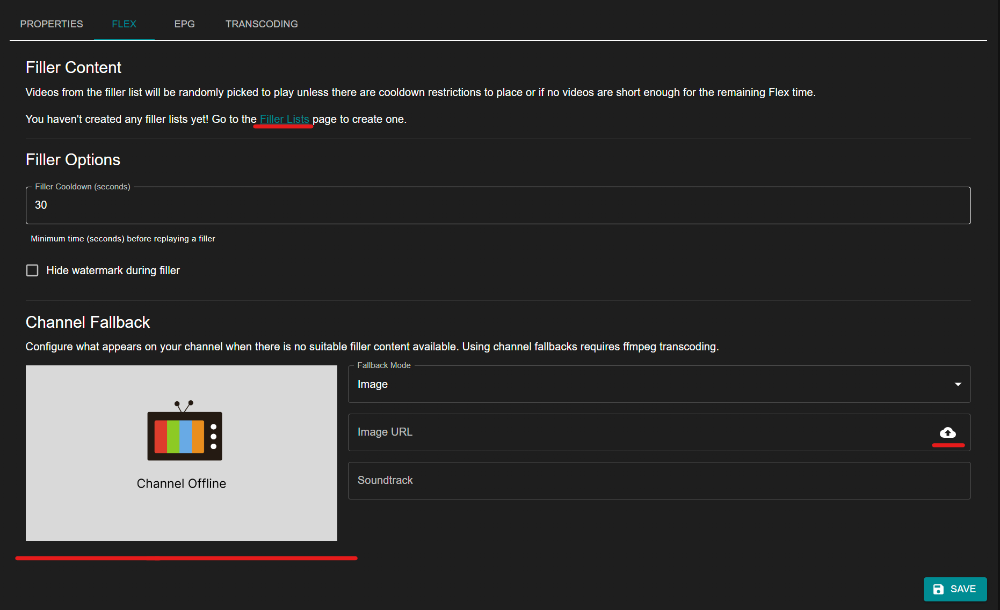
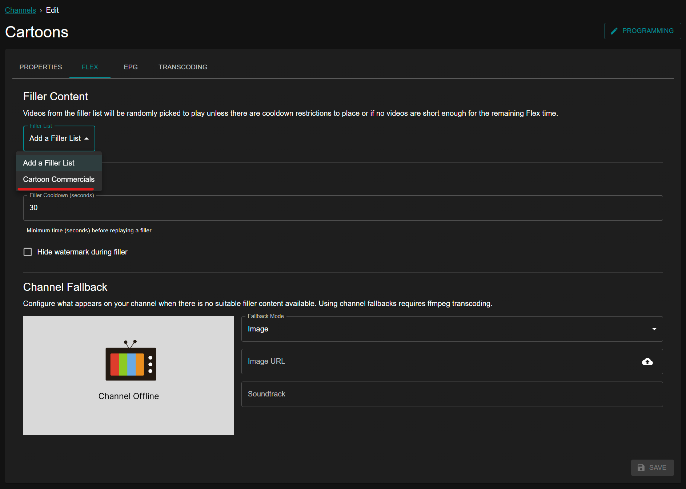

# Flex

Flex is an optional block of time that is used to separate two episodes of television. One reason to use Flex time is to create commercial breaks after each episode to simulate traditional television.

There are a few ways to create Flex time such as Time Slots. When you have Flex time but no Filler Content configured, the Channel Fallback shown in the screenshot below will be used.

## Channel Fallback

The Channel Fallback plays whenever no filler is eligible. Choose its **Fallback Mode** on the channel's Flex tab.

| Mode | What plays |
| --- | --- |
| **Image** | A still image, with an optional soundtrack. Select the upload button to use your own image. |
| **Library Clip** | A video from your libraries. Search for a movie, episode, music video, or other video by title. |

An Image fallback plays silence unless you set a **Soundtrack**. Enter a path or URL to an audio file, or select the upload button to store one on the Tunarr server. The soundtrack loops for as long as the fallback plays.

A Library Clip plays from the start when it fits in the gap. When the gap is shorter than the clip, Tunarr plays the end of the clip so it finishes when the gap does. When the gap is longer, the clip plays again until the gap ends.

## Filler

Please see the [Filler Lists page](/configure/library/filler) for details on creating your first list. 

Once you have a Filler list created, you can select the list you'd like to use on a particular channel.

Once you have a Filler list added to a channel, it will only be used when there is Flex time scheduled, such as when using [Time Slots](/configure/scheduling-tools/time-slots) with the Pad Times feature. 