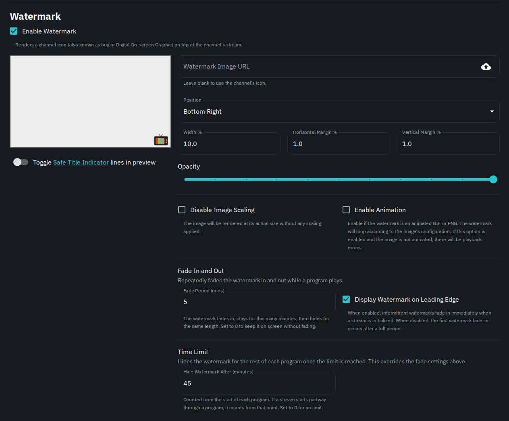

# Channel Watermarks

Channels can have watermarks to aid in recreating a classic TV experience.

There are many ways to customize watermarks for a channel. Here are some details on specific options:

### Fade in and out

**Fade Period** fades the watermark in and out on a cycle while a program plays. With a period of 5 minutes, the watermark shows for 5 minutes, then hides for 5 minutes, and repeats. Set it to 0 to keep the watermark on screen without fading.

**Display Watermark on Leading Edge** decides whether the watermark starts visible (enabled) or hidden (disabled). It only appears when a fade period is set.

### Time limit

**Hide Watermark After** hides the watermark for the rest of each program once this many minutes have passed. Decimals work, so 1.5 means 90 seconds. The count starts when the program starts playing on the stream. If a stream starts partway through a program, the count starts from that point. Channels on the [ErsatzTV next](../ffmpeg/ersatztv-next.md#watermarks) backend always count from the program's start. It overrides the fade settings but works alongside them. For example, a fade period of 5 minutes with a limit of 45 minutes on an hour-long show fades the watermark in and out for the first 45 minutes, then hides it for the final 15. Set it to 0 for no limit.

## Overrides

Global settings, such as target resolution, bit rate, and buffer size can be overridden per-channel.
