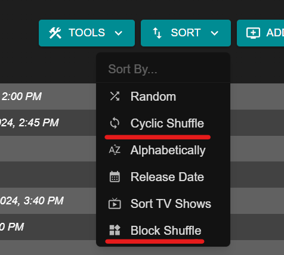

# Cyclic Shuffle

Cyclic Shuffle alternates between shows at random while preserving each show's episode sequence. It is a preset of [Block Shuffle](block-shuffle.md) with these options:

| Option | Value |
|---|---|
| # of Programs | 1 |
| Episode Order | In Order |
| Show Order | Random |
| Starting Episode | Random Episode |
| Loop Short Programs | Off |

<figure markdown="span">
    
    <figcaption>Cyclic and Block shuffle buttons</figcaption>
</figure>

A sample cyclic shuffled schedule with 3 shows could be something like:

1. Show A, S02E03
2. Show B, S01E02
3. Show A, S02E04
4. Show C, S04E01
5. Show C, S04E02
6. Show B, S01E03

Each show plays once per episode in the lineup, so shows with more episodes come up more often.

To change the preset, open Block Shuffle and set the options yourself. For example:

- Set Starting Episode to First Episode to start every show at its first episode.
- Turn on Loop Short Programs to make every show play equally often, with shorter shows starting over.
