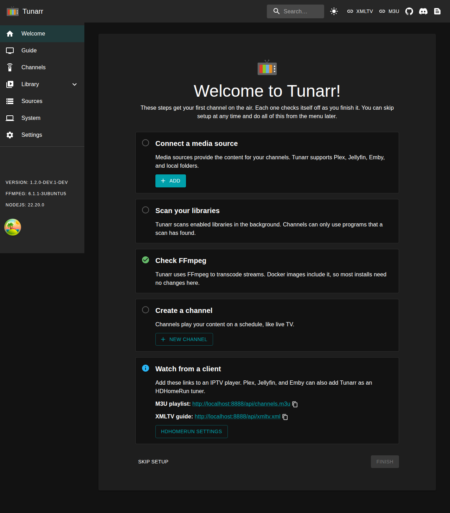
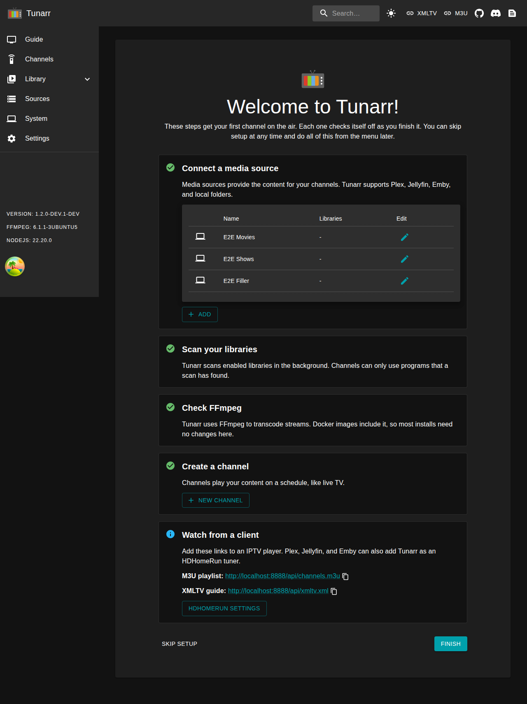

# Setup

## Initial Setup

The first time you open Tunarr, it shows a Welcome page with a setup checklist. By default, Tunarr is available at http://localhost:8000.

Each step checks itself off once it is done. You don't have to follow the checklist. Click **Skip Setup** to go straight to the guide, and do everything from the menu instead. Once you skip or finish, Tunarr stops showing the page. Installs upgraded from a version without the checklist never see it.

### Connect a media source

Tunarr supports Plex, Jellyfin, Emby, and local media as media sources. You must connect at least one media source and enable at least one of its libraries before you can add programming to your channels. Each media source acts as a metadata source for your programming, and optionally, the streaming source.

See the [media sources](../configure/media_sources) page for more info on configuring media sources!

### Scan your libraries

Tunarr scans enabled libraries in the background. This step checks itself off when the first scan finishes. Channels can only use programs that a scan has found.

### Check FFmpeg

!!! info
    FFmpeg is included in Tunarr Docker images, so Docker users should not need to make any changes here.

Tunarr requires [FFmpeg](https://ffmpeg.org/). FFmpeg is used to normalize channel video / audio streams for seamless playback, interleave your "flex" content, and more. Tunarr defaults to looking for the FFmpeg executable at `/usr/bin/ffmpeg`. If no executable is found, or the version is too old, this step shows the problem and links to the FFmpeg settings page, where you can change the path. The minimum known supported version of FFmpeg is 6.1. The recommended version is 7.1.1. We recommend [this build of FFmpeg](https://github.com/ErsatzTV/ErsatzTV-ffmpeg/releases/tag/7.1.1) as it matches what is shipped in Tunarr docker containers.

### Create a channel

Click **New Channel** to [create your first channel](/configure/channels/properties).

### Watch from a client

This step lists the M3U playlist and XMLTV guide links to add to an IPTV player. Plex, Jellyfin, and Emby can also add Tunarr as an HDHomeRun tuner. This step is optional.

Click **Finish** once every required step is checked off.

